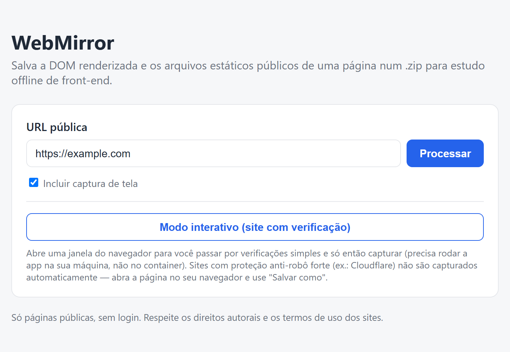

# WebMirror

**Ferramenta local e open-source para salvar páginas web públicas como um `.zip` e estudá-las offline.**

O WebMirror captura a **DOM já renderizada** de uma página pública (o HTML depois do JavaScript rodar) junto com seus **arquivos estáticos** (CSS, JS, imagens e fontes), reescreve os caminhos para ficarem relativos e empacota tudo num `.zip`. O objetivo é **estudo de front-end e engenharia**: analisar estrutura, componentes, layout e CSS de uma página **sem depender de internet**.

Roda **na sua máquina** (Docker ou Node direto). **Sem IA interna, sem nuvem, sem telemetria.**

<p align="center">
  
</p>

---

## ⚖️ Escopo e ética (leia antes de usar)

O WebMirror foi feito para **estudo de páginas públicas**. Ele:

- opera **apenas sobre dados públicos** acessíveis por um navegador comum;
- **não** acessa áreas logadas, **não** faz phishing, **não** burla autenticação e **não** contorna verificações anti-robô.

Use com responsabilidade e **respeite os direitos autorais** e os termos de uso dos sites. A captura é para estudo; redistribuir conteúdo de terceiros é com você.

---

## 🧩 Como funciona

Esta versão oferece **duas formas de capturar**:

| Modo | Quando usar | Como |
|---|---|---|
| **Automática** | Uma página, sem interação | Um navegador controlado (Playwright) abre a página, renderiza e captura. |
| **Interativa** | Você quer navegar e/ou salvar **várias páginas** | Abre uma janela que **você** controla: navegue até a página desejada e clique em capturar. Pode repetir para outras páginas — os **links entre as páginas capturadas ficam locais** (apontam para os arquivos do `.zip`); os demais continuam online. |

### Pipeline de captura

```
URL pública
   │
   ▼
Playwright (Chromium) abre e renderiza a página
   │
   ▼
DOM renderizada + coleta de CSS/JS/imagens/fontes
   │
   ▼
Reescrita de caminhos → ./assets/...   (abre offline)
   │  vídeos: públicos viram embed online; restritos viram um vídeo de exemplo
   ▼
server.js empacota tudo num .zip  (Express + archiver)
```

### Por que Playwright (e não HTTrack/Wget/curl)

O WebMirror usa um **navegador real** ([Playwright](https://playwright.dev/)/Chromium) para capturar a página **depois** que o JavaScript rodou — algo que `curl`, `wget` e HTTrack **não** fazem (eles baixam o HTML cru, sem executar scripts). Por isso o WebMirror funciona com páginas modernas (SPAs) que montam o conteúdo via JavaScript.

---

## 🚀 Começando

### Rodar com Docker

```bash
docker compose up --build -d
```

Abra `http://localhost:18780`. Os `.zip` aparecem em `./downloads`.
O **modo interativo** não funciona dentro do container (sem tela) — para ele, rode sem Docker.

### Rodar sem Docker

Requisitos: **Node 22+** (recomendado o 24).

```bash
npm install
```
```bash
npm run browsers
```
```bash
node server.js
```

Abra `http://localhost:18783` (ou a porta do seu `.env`).

> **Windows:** se a política do PowerShell bloquear `npm`/`npx` (`.ps1` não pode ser carregado), use o equivalente com `node` direto, por exemplo `node .\node_modules\playwright\cli.js install chromium` no lugar de `npm run browsers`.

### Configuração

Copie `.env.example` para `.env` e ajuste: porta, limites de tamanho, retenção dos `.zip`, modo interativo. Vale igual com e sem Docker.

---

## 📦 Dentro do `.zip`

```
index.html         DOM renderizada, com caminhos relativos para ./assets
assets/css|js|img|fonts
assets/webmirror/  internos do WebMirror (ex.: vídeo de exemplo)
screenshot.jpg     página inteira (quando pedido)
webmirror.json     manifesto: arquivos salvos, mídias trocadas, avisos
LEIA-ME.txt        como abrir e o que é cada parte
```

---

## ✅ O que ele captura bem × ⚠️ limites honestos

**Captura bem:**
- Estrutura HTML e a DOM renderizada (pós-JavaScript).
- CSS, JavaScript, imagens e fontes.

**Limites (inerentes ao assunto):**
- **Não rastreia o site sozinho:** a captura automática pega **uma página**. Para salvar **várias**, use o **modo interativo** e navegue você mesmo (captura manual, página por página) — os links entre as páginas capturadas ficam locais; os demais seguem online. (Rastreamento automático de domínio não faz parte desta versão.)
- **Vídeos:** públicos viram embed online (não pesam o `.zip`); restritos (link assinado/streaming/login) viram um vídeo de exemplo.
- **Sites protegidos por verificação anti-robô** (ex.: Cloudflare) não podem ser capturados automaticamente — por design, essas proteções barram navegadores automatizados. O WebMirror **não** as contorna.
- Conteúdo em `<iframe>` de outro domínio e *shadow DOM* fechado ficam como link.
- Arquivos de terceiros sem CORS continuam apontando para o original (precisam de internet).

---

## 🗂️ Estrutura do projeto

```
server.js            app local (Express): captura, empacota e serve o .zip
server-assets/       recursos embutidos (ex.: vídeo de exemplo)
Dockerfile           imagem baseada na imagem oficial do Playwright
docker-compose.yml   orquestração (porta, limites)
.env.example         variáveis de configuração
```

---

## 🔒 Privacidade

Tudo roda **localmente**. O WebMirror não envia suas páginas, seus dados ou sua navegação para lugar nenhum. Não há IA, nuvem nem telemetria. Os `.zip` ficam na sua máquina (`./downloads`).

---

## 🙏 Créditos e dependências

Construído sobre projetos open-source, a quem agradecemos:

| Projeto | Licença | Papel |
|---|---|---|
| [Node.js](https://nodejs.org/) | MIT | Runtime |
| [Playwright](https://playwright.dev/) | Apache-2.0 | Navegador real (renderização) |
| [Express](https://expressjs.com/) | MIT | Servidor local |
| [archiver](https://www.npmjs.com/package/archiver) | MIT | Geração do `.zip` |

Essas dependências **não são redistribuídas** neste repositório — elas são baixadas por você com `npm install`. As respectivas licenças pertencem aos seus autores.

---

## ⚠️ Aviso legal / Uso responsável

- O WebMirror é uma **ferramenta de estudo**, de propósito geral e **dual-use**, no mesmo espírito do "Salvar página como" do navegador, do `wget` ou de arquivadores de site. A **ferramenta em si** é neutra.
- **A responsabilidade pelo uso é de quem usa.** Você é responsável por respeitar os **direitos autorais**, os **termos de uso** e a **legislação** aplicável aos sites que capturar.
- Capture apenas **páginas públicas** que você tem o direito de acessar, e **não** redistribua conteúdo de terceiros sem permissão.
- As capturas (`.zip`, imagens, etc.) ficam **só na sua máquina** e **não** fazem parte deste repositório.
- Software fornecido "COMO ESTÁ", sem garantias (ver [LICENSE](LICENSE)).

---

## 📄 Licença

[MIT](LICENSE) © Leomar de Sousa Leite.

Você pode usar, estudar, modificar e redistribuir — **desde que mantenha o aviso de copyright e a licença** (dando crédito ao autor). Veja o arquivo [LICENSE](LICENSE) para o texto completo.
